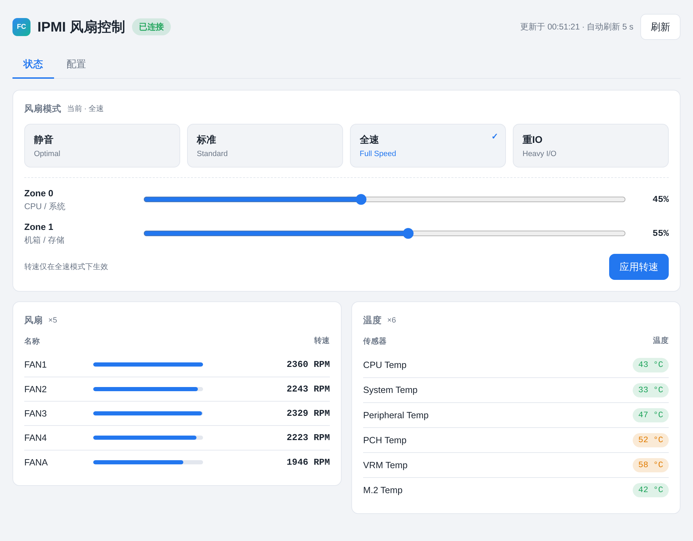
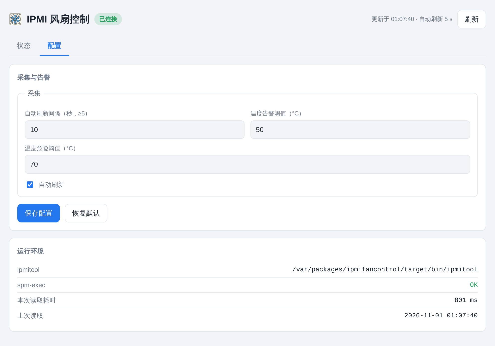
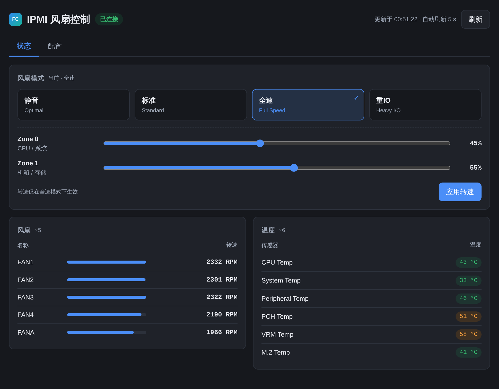

# IPMI Fan Control（群晖 DSM 7 套件）

通过 IPMI 读取服务器风扇转速与温度、并切换超微（Supermicro）风扇模式的 Synology DSM 7 原生套件。
套件中心手动安装后，DSM 桌面出现 **IPMI 风扇控制** 磁贴，点击以 **DSM 原生应用窗口**打开
（可拖动、可调大小、可最大化，与 File Station 同形态），所有操作在窗口内完成——
无需 SSH、无需 Docker、无需改环境变量。

> 本套件的工程结构与界面风格与 [IP-Monitor-DSM](https://github.com/MeowPerth/IP-Monitor-DSM) 对齐：
> 同一套 `src/ + spk/` 目录骨架、同一套 DSM 原生窗口注册方式、同一套明暗主题设计令牌。

## 预览

| 状态页 | 配置页 |
|---|---|
|  |  |

深色主题（跟随 DSM / 系统外观）：



## 功能

- **原生应用窗口**：DSM 桌面磁贴 + 窗口内嵌 UI，不新开网页
- **风扇 / 温度监控**：一次 `ipmitool` 批量调用读回模式、两区转速、风扇 SDR、温度 SDR（约 0.3–1 s）
- **四种风扇模式**：Standard / Full Speed / Optimal / Heavy I/O，一键切换
- **自定义转速**：Full Speed 模式下分别设置 Zone 0（CPU/系统）与 Zone 1（机箱/存储）转速百分比
- **温度阈值**：告警 / 危险阈值可配置，读数按阈值着色（默认 50 °C / 70 °C）
- **零暴露端口**：UI → 同源 `api.cgi`（DSM nginx 执行）→ `spm-exec` → `ipmitool`，套件不监听任何 TCP 端口
- **双通道认证**：DSM 会话（官方 `authenticate.cgi`）+ 安装期实例 token 兜底
- **无守护进程**：风扇/温度按需读取，没有常驻后台服务，安装/卸载都轻
- **UI**：状态/配置分页、明暗主题、中英文自适应、自动刷新与倒计时

## 安装

1. 下载 [Releases](https://github.com/MeowPerth/IPMIFanControl/releases) 中的 `.spk`
2. 先在套件中心安装 [SimplePermissionManager](https://synopackage.com/simplepermissionmanager/)
   （本套件需要以 root 身份执行 `ipmitool` 访问 BMC）
3. 套件中心 → 右上角「手动安装」→ 选择该文件
4. 提示「发布者未经 Synology 验证」属正常（未申请官方签名），继续安装
5. 在 SimplePermissionManager 中授权 **IPMI 风扇控制** 以 root 权限启动
6. 安装完成后，DSM 主菜单出现 **IPMI 风扇控制**，点击即可打开

> 若磁贴行为异常或窗口空白，注销并重新登录 DSM 刷新主菜单缓存。

> **已验证环境**：DSM 7.4.0（SA6400 / epyc7002）。实测通过：风扇与温度读取、
> 四种模式切换、Zone 0/1 转速写入、DSM 原生窗口加载、升级保留配置与 token、
> 未登录请求拦截（返回 `unauthorized`）、SPM 提权链路。

## 使用

- **状态页**：顶部显示连接状态与自动刷新倒计时；「风扇模式」四个按钮一键切换；
  选中 **全速（Full Speed）** 时展开 Zone 0 / Zone 1 转速滑杆，点「应用转速」写入 BMC；
  下方两栏分别列出风扇名称/转速（横条为相对转速）与温度传感器读数（按阈值着色）
- **配置页**：自动刷新间隔（≥5 s，可关闭）、温度告警/危险阈值、运行环境（ipmitool 路径、
  spm-exec 是否就绪、上次读取耗时）
- 配置文件保存后立即生效，无需重启套件

| 模式 | IPMI 值 | 说明 |
|---|---|---|
| Standard（标准） | `0x00` | 默认自动调速 |
| Full Speed（全速） | `0x01` | 风扇全速运转，可自定义转速 |
| Optimal（静音） | `0x02` | 优先静音 |
| Heavy I/O（重IO） | `0x04` | 高负载场景 |

## 工作原理

```
DSM 桌面磁贴（src/ui/config 注册 MeowPerth.IPMIFanControl.AppInstance）
   └─ 应用窗口（src/ui/dsm-wrapper.js）→ iframe → /webman/3rdparty/ipmifancontrol/index.html
          │                                        （DSM 托管，与 DSM 同源）
          └─ fetch api.cgi?action=status|set_mode|set_duty|config
                 └─ CGI（DSM nginx 执行，套件用户身份）
                        └─ spm-exec（SimplePermissionManager 提权）
                               └─ ipmitool raw 0x30 ... / sdr type Fan|Temp
                                      └─ /dev/ipmi0 → BMC
```

- 窗口注册：`src/ui/dsm-wrapper.js` 定义 `SYNO.SDS.AppInstance` / `SYNO.SDS.AppWindow`，
  `INFO.dsmappname` 指向 AppInstance 类名，`src/ui/config` 以 `"dsm-wrapper.js"` 为节键声明
- 认证：`api.cgi` 先校验 token（请求头 `X-IPMIFan-Token` 或 Cookie `ipmifan_token`），
  再执行官方 `authenticate.cgi` 校验 DSM 会话；两者都不通过返回 `{"error":"unauthorized"}`
- 读取：一次 `sh -c` 里串行执行 5 条 `ipmitool` 命令并用 `==TAG==` 分节，
  避免每次刷新拉起多个进程；设置模式/转速时把写命令并入同一次调用，随后读回最新状态
- 解析：`ipmitool sdr` 的竖线表格按名称 + 含单位的列解析，兼容 `na`（无读数）与非常规列数

## API（`src/ui/api.cgi`）

恒返回 HTTP 200 + JSON，成败由 body 的 `error` 字段表达。

| Action | 方法 | 说明 |
|---|---|---|
| `status` | GET | 模式、Zone 0/1 转速、风扇列表、温度列表、运行环境 |
| `set_mode` | POST | body `{"mode":"standard\|full_speed\|optimal\|heavy_io"}`，返回最新状态 |
| `set_duty` | POST | body `{"zone":0\|1,"percent":0-100}`，返回最新状态 |
| `config` | GET | 读取界面配置 |
| `config_put` | POST | 保存界面配置（字段白名单 + 范围收敛 + 阈值校验） |

POST 同时支持 JSON body 与表单 `payload=<json>`（页面用后者，避免 CGI 的 content-type 兼容问题）。

### 使用的 IPMI 命令（超微私有）

```
ipmitool raw 0x30 0x45 0x00                    # 读取风扇模式
ipmitool raw 0x30 0x45 0x01 <mode>             # 设置风扇模式
ipmitool raw 0x30 0x70 0x66 0x00 <zone>        # 读取区域转速
ipmitool raw 0x30 0x70 0x66 0x01 <zone> <pct>  # 设置区域转速
ipmitool sdr type Fan                          # 风扇 SDR
ipmitool sdr type Temp                         # 温度 SDR
```

## 配置与数据位置

```
/var/packages/ipmifancontrol/var/   →   /volume1/@appdata/ipmifancontrol/
├── config.json     界面配置（卸载后保留）
└── token           实例 token（安装期生成，注入页面作认证兜底）
```

**卸载不会删除配置**：卸载仅移除程序文件（`@appstore`、`/var/packages` 链接、`3rdparty` 软链），
数据目录保留，重装后自动复用。需彻底清除时手动删除该目录即可。

## 从源码构建

```bash
./build.sh
# → dist/ipmifancontrol_x86_64-dsm7_1.0.0-0003.spk
```

只需 bash、tar、gzip、md5sum、python3，无需 Synology SDK 或 spksrc。
`build.sh` 会自检 Python CGI 语法、JSON 文件、token 占位符与图标是否齐全，
并把 `package.tgz` 的 md5 写进 `INFO` 的 `checksum`。

图标由纯标准库脚本生成（无 PIL / ImageMagick 依赖）：

```bash
python3 tools/make_icons.py src/ui/images     # → ipmifan_{16,24,32,48,64,72,256}.png
```

## 本地调试（无需 NAS / 无需 IPMI 硬件）

```bash
python3 tools/dev_server.py                   # http://127.0.0.1:8799
```

默认返回**内置模拟数据**（一台超微主板的典型读数），改 UI 立刻能看到效果；
加 `--real` 则真正执行 `src/ui/api.cgi`（本机装了 `ipmitool` 时读真机）：

```bash
python3 tools/dev_server.py --real --port 9000
```

## 目录结构

```
├── build.sh                     # 一键打包 → dist/*.spk
├── src/
│   ├── bin/ipmitool             # 内置 ipmitool（x86-64）
│   └── ui/
│       ├── index.html           # 应用窗口单页（明暗主题 / 中英文 / 分页）
│       ├── api.cgi              # Python 标准库 CGI：鉴权 + 批量 ipmitool + JSON
│       ├── dsm-wrapper.js       # DSM 原生窗口注册（Ext JS）
│       ├── config               # 磁贴 / 窗口声明
│       └── images/              # 图标（16–256）
├── spk/
│   ├── scripts/                 # installer + 六个生命周期薄壳 + start-stop-status
│   ├── conf/privilege           # run-as package / sc-ipmifancontrol
│   └── var-default-config.json  # 首装默认配置
├── tools/
│   ├── make_icons.py            # 纯标准库生成图标
│   └── dev_server.py            # 本地开发服务器（模拟 / 真实两种模式）
└── docs/screenshots/
```

## 说明与已知限制

- **包名变更（1.0.0-0002 起）**：套件 ID 由 `IPMIFanControl` 改为小写 `ipmifancontrol`，
  与 IP-Monitor-DSM 命名风格一致。DSM 会视为新套件，从 `1.0-0001` 升级需先卸载再安装
  （配置目录保留，重装后复用）。
- **仅 x86 平台**：内置的 `ipmitool` 为 x86-64 ELF，`INFO` 中只声明 x86 平台 arch。
- **需要 IPMI 内核支持**：必须存在 `/dev/ipmi0`；安装日志（`/var/log/packages/ipmifancontrol.log`）
  会在缺失时给出警告。
- **仅超微私有命令**：风扇模式/转速走 `raw 0x30 0x45` / `0x30 0x70 0x66`，
  其他厂商主板通常不可用；此时界面显示"未读取到 IPMI 数据"。
- **root 权限依赖**：`ipmitool` 需经 SimplePermissionManager 的 `spm-exec` 提权，
  未授权时状态页会提示。
- 未申请 Synology 官方签名，手动安装时的"不受信任"提示属正常。

## 许可

见 [LICENSE](LICENSE)。内置 `ipmitool` 采用 BSD-3-Clause 许可。
